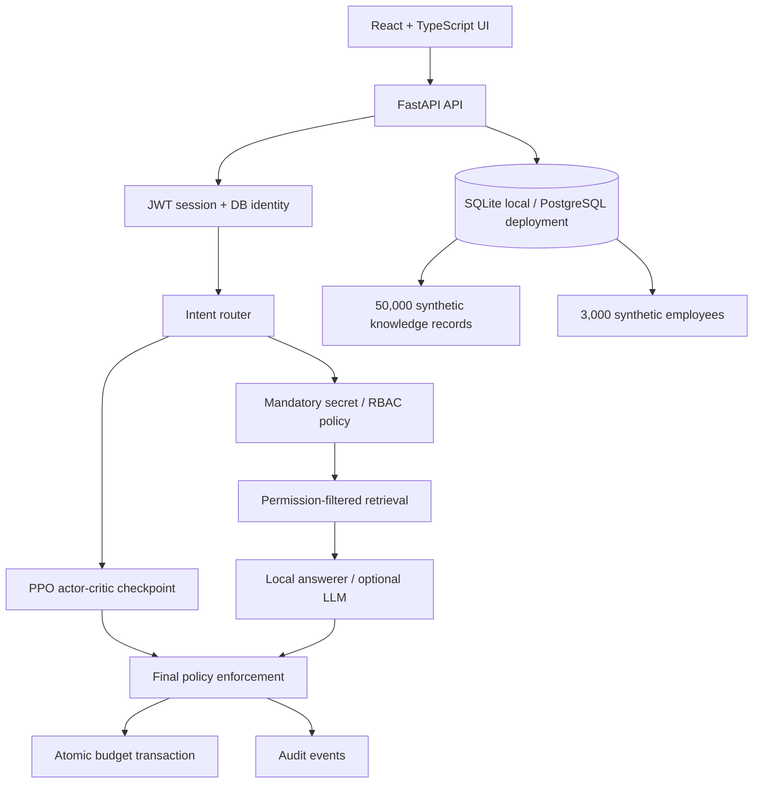

# Architecture

## Request order

1. Validate signed token and load the employee row.
2. Route greeting/coding/company/sensitive/credential intent.
3. Reject credentials and unauthorized sensitive requests before document retrieval.
4. Filter document access by classification, role, and department before context construction.
5. Derive five normalized state features and obtain a PPO recommendation (or explicitly marked safe fallback).
6. Enforce mandatory policy rules after the recommendation.
7. Generate only from permitted evidence; return no-answer if evidence is absent.
8. Apply a response-level secret refusal, charge the enterprise disclosure allowance, and persist a budget transaction and audit event.

PPO is a decision recommendation, never an authorization boundary.
